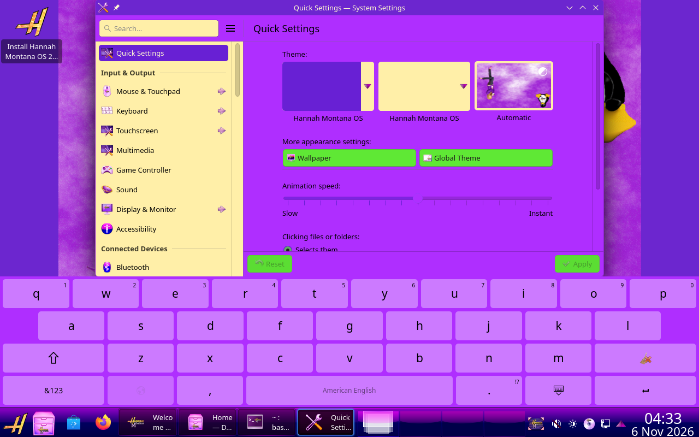

# Hannah Montana OS 2026

Edición comunitaria de Hannah Montana Linux modernizada sobre Kubuntu 26.04.1, con KDE Plasma, fondos HD e identidad visual de Hannah Montana. Proyecto no oficial, sin afiliación con Disney, Hannah Montana, KDE ni Canonical.



## Descargar

La imagen de esta edición se llama **`hannah-montana-os-26.04.1-2026-amd64.iso`** (5.554.634.752 bytes). Las descargas se publican en [Releases](https://github.com/amadeus177153/HannaH-Montana-Os-2026/releases). La imagen se distribuye en tres partes porque cada archivo de una release de GitHub debe ocupar menos de 2 GiB.

Descarga las tres partes `.part001`, `.part002` y `.part003`, `SHA256SUMS`, `SHA256SUMS.parts` y `unir_iso.py` de la misma release. Colócalos en una carpeta y ejecuta con Python 3:

```sh
python unir_iso.py
```

En Windows también puedes ejecutar `py unir_iso.py`. El script verifica las partes y la imagen completa antes de guardar la ISO. Necesitas espacio para las partes y para la imagen reconstruida (aproximadamente 11,2 GB en total). **Las partes no se graban individualmente en la USB.**

SHA-256 de la ISO:

```text
0e8320f72fbbd5a646f155ad03944cd74ac4404cf83d6e5a4686eb59a8641668
```

En Linux puedes comprobar la imagen reconstruida con `sha256sum -c SHA256SUMS`. Graba la ISO completa como imagen de disco en una USB; prueba primero sin reutilizar persistencia de ediciones anteriores.

## Cambios de esta edición

- Iconos originales reescalados junto con su transparencia; corregidos los recortes de Configuración, Internet y otras aplicaciones.
- Indicadores del panel heredados de Breeze y estilo de aplicaciones Breeze, conservando los colores de Hannah Montana.
- Inicio de sesión Wayland con la envoltura D-Bus de Plasma.
- Qt Quick por software para mejorar compatibilidad; puede reducir el rendimiento según el equipo.
- Configuración de entrada táctil, modo tableta automático y teclado virtual Plasma. El funcionamiento depende del hardware y la aplicación.
- Opción de gráficos seguros en el menú de arranque.

## Instalación y Windows

El instalador requiere **30 GiB de almacenamiento y 4 GiB de RAM**. La ISO admite arranque BIOS y UEFI.

Es posible instalar junto a Windows. Ambos sistemas deben utilizar el mismo modo de arranque; para Windows instalado en UEFI, inicia también la USB en UEFI. Respalda tus datos, comprueba BitLocker y conserva su clave de recuperación antes de cambiar almacenamiento o particiones. Reduce la partición de Windows desde su Administrador de discos y usa el espacio sin asignar para Linux. Conserva las particiones de Windows y reutiliza su partición EFI sin formatearla; no elijas borrar el disco.

Si el SSD no aparece en Linux y la controladora utiliza Intel RST/RAID, puede ser necesario cambiar a AHCI en el firmware. AHCI también permite usar Windows, pero hay que prepararlo antes del cambio para evitar errores de arranque. Consulta el [procedimiento oficial de Ubuntu](https://ubuntu.com/desktop/docs/en/24.04/how-to/reconfigure-windows-to-use-ahci/). En una prueba del usuario, cambiar de RAID/RST a AHCI resolvió la detección del SSD. No es necesario reconstruir esta ISO para ese ajuste.

La instalación completa y el dual boot de esta edición todavía no se han validado de principio a fin. El usuario confirmó el funcionamiento del Live y la detección del almacenamiento con AHCI; el rendimiento sigue pendiente de diagnóstico.

## Validación

Se probó el arranque Live mediante BIOS y UEFI en QEMU/KVM, la apertura y permanencia de Dolphin, Konsole y Configuración, la apertura de Calamares, y la interacción táctil y el teclado virtual mediante un dispositivo virtual. Se comprobaron archivos de la ISO final y su SHA-256.

No se validaron una pantalla táctil física, Secure Boot en firmware real ni una instalación completa a disco. El cierre de aplicaciones informado en una edición anterior no se reprodujo en la máquina virtual. Consulta el [informe de validación](docs/VALIDACION.txt).

## Fuentes de construcción

[build/](build/) conserva los scripts de modernización, reescalado y reparación utilizados en las distintas etapas. [docs/CONSTRUCCION.md](docs/CONSTRUCCION.md) explica sus dependencias y límites. Los sistemas raíz extraídos y las imágenes binarias se mantienen fuera de Git.

Los paquetes, marcas, imágenes y demás recursos de terceros conservan sus respectivas licencias y derechos. Este repositorio no concede permisos adicionales sobre ellos.
